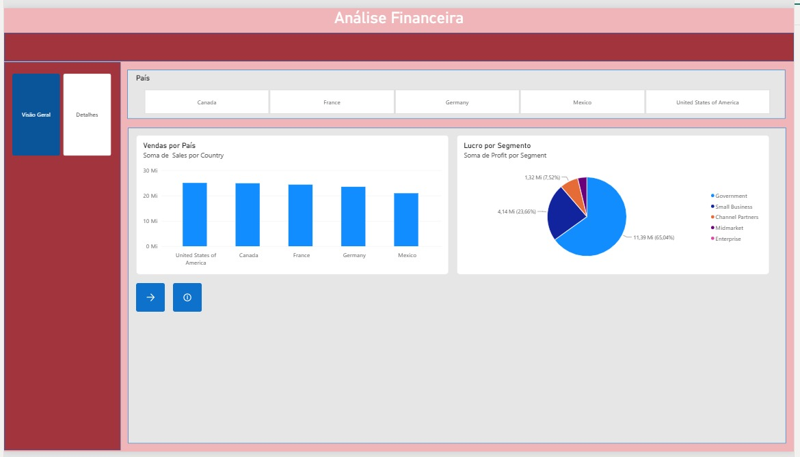
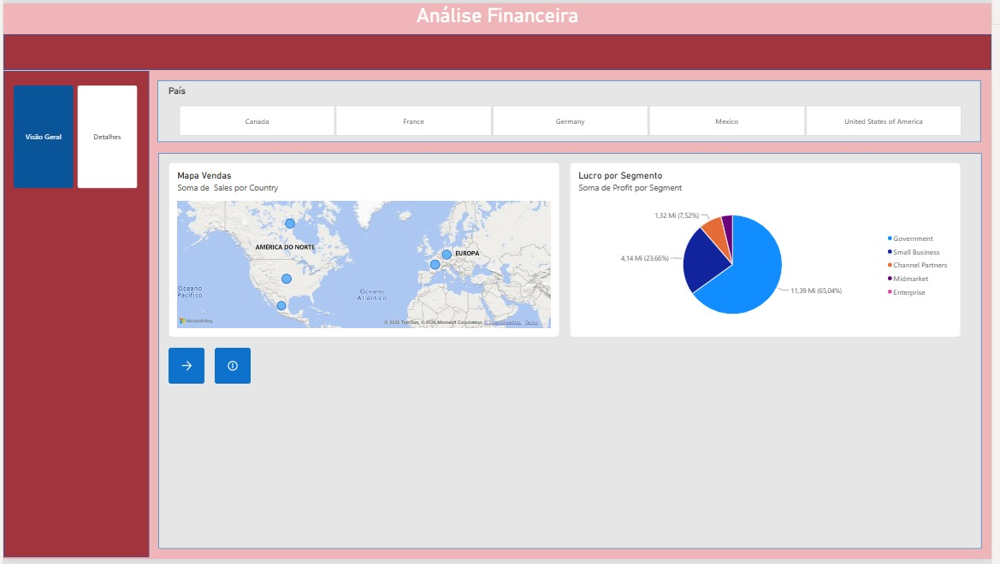
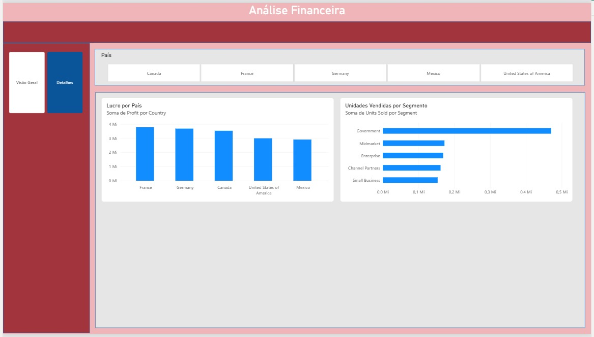

# Desafio DIO: Relatório Financeiro Interativo no Power BI

Projeto prático do desafio da DIO sobre Power BI, usando a base **Financial Sample** (tabela `financials`).

## 🎯 Objetivo

Criar um relatório mais elaborado, com estrutura definida, navegação entre páginas, filtros e botões para alternar visuais.

## 🧱 Estrutura do relatório

- **Cabeçalho** com o título do relatório
- **Menu lateral** com botões de navegação entre as páginas
- **Faixa de filtros** com segmentador de país
- **Área de gráficos**

## 📄 Páginas

### Visão Geral
- **Vendas por País:** pode ser visto como gráfico de colunas ou como mapa, alternando por botões com ícone (indicadores)
- **Lucro por Segmento:** gráfico de pizza

### Detalhes
- **Lucro por País:** gráfico de colunas
- **Unidades Vendidas por Segmento:** gráfico de barras

## 🔧 Recursos utilizados

| Recurso | Para que serve |
|---|---|
| Segmentador de país | Filtra os gráficos pelo país escolhido |
| Navegador de páginas | Botões do menu para trocar de página |
| Indicadores (bookmarks) | Guardam cada versão da página (colunas ou mapa) |
| Botões com ícone | Chamam os indicadores para alternar o visual |

## 🖼️ Prints

## ⚠️ Publicação

O desafio pede a publicação no Power BI Service. Não consegui publicar porque a plataforma exige e-mail de trabalho ou escola, e eu só tenho e-mail pessoal. Por isso, o relatório está disponível no arquivo `.pbix` deste repositório.

## 📁 Conteúdo do repositório

- `desafio-2-power-bi.pbix`: projeto do Power BI
- `Financial Sample.xlsx`: base de dados utilizada
- Prints das páginas (arquivos `.jpeg`)

## ▶️ Como abrir

1. Instale o **Power BI Desktop** (gratuito, só para Windows).
2. Baixe o arquivo `desafio-2-power-bi.pbix`.
3. Abra no Power BI Desktop.
4. Para testar os botões, segure **Ctrl** e clique neles.

## 🧠 O que aprendi

Aprendi a criar um layout, usar segmentadores e implementar botões de navegação e indicadores.

## 🔗 Referências

- Repositório do curso: https://github.com/julianazanelatto/power_bi_analyst
